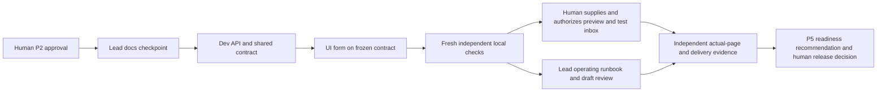

# Reliable Inquiries Implementation Plan — version 1 (APPROVED)

> For AI: human explicitly approved this exact plan as implementation_plan=approve_plan_v1_d011 (D011). Execute only owned bounded briefs in order. No production code authored by lead; no self-verification. Actual live/account/release permissions remain separate.

**Goal:** Implement the human-approved inquiry spec on reviewable branches, prove local contracts independently, and identify remaining live-delivery/launch prerequisites without changing accounts or shipping.

**Architecture:** Existing Next contact route sends synchronously to Resend and acknowledges provider acceptance only. Browser-safe shared Zod contract drives API/form normalization, errors and frozen same-ID retries. No app database/outbox, SDK, new vendor or background service.

**Tech stack:** Next 16.0.7, React 18.3.1, TypeScript 5.2.2, installed Zod, Node 24.11.1 native Request/Response and proposed native node:test/TypeScript-stripping path. Native test feasibility is not yet proven. Effective approved spec: docs/specs/reliable-inquiries.md plus reliable-inquiries-v2.md overrides; D004–D010.

---

## 1. Framework, options, inputs and proposed ranking
Dependency-first MoSCoW, not numerical RICE. Reach, lost inquiries, revenue impact, total effort and elapsed schedule are Unknown; scores/dates would invent precision.

| Outcome option | Evidence/source | Effort range/source | Proposal / trade-off |
|---|---|---|---|
| Truthful contact acceptance + failure recovery | Current handler source; human first-outcome choice D004/D006; approved v2 | Dev elapsed Unknown; UI 8–14 active hours estimated, conditional builder report | MUST now: API contract before UI; correct false success without a new datastore |
| Real provider/inbox validation + baseline readiness | Accepted metric and AC1–8; domain/config/export currently Unknown | External lead time Unknown | MUST gate release; cannot substitute local fixtures for delivery |
| Sanity account/content transition | New account/preservation intent; current access Unknown | Unknown | Separate blocked increment; local inquiry code can proceed, full Contact-page/live proof requires approved config |
| Gallery/blog/optional redesign/cleanup | Initial source backlog; not first chosen outcome | Unknown | DEFER: does not displace approved inquiry work without explicit scope trade |

Builder reports/limitations: docs/plans/inquiry-builder-findings.md. UI estimate assumes frozen spec, usable nonproduction surface/tools and limited correction; excludes API, environment repair, independent checks/live sends. Developer did not supply an elapsed estimate. No aggregate estimate or delivery date. Time/pass budgets below are STOP CAPS, not estimates or promises.

## 2. Increment and acceptance boundary
Deliver complete contact code, behavior regression checks, environment example, operating/baseline runbook and draft review PRs. All AC1–8 trace to the effective spec; do not reduce their scope. Local fixture checks can establish application contracts only. Real provider dedup, recipient-mail-server event/inbox observation, complete actual-page accessibility and rollout baseline remain separately authorized prerequisites. Candidate code can be done-unverified with those explicit blocks; do not claim feature verified or ready to launch.

No account creation, token/DNS/CORS/environment mutation, paid upgrade/overage, install, dependency/lockfile change, Sanity migration, real send, default-branch commit/merge or deployment. Preserve user-owned package-lock.json modification and all existing content/images.

## 3. Task graph and owners

| Task | One owner | Single acceptance criterion | Owned files/resources |
|---|---|---|---|
| L0 docs checkpoint | cielitos-lead | Approved source-of-truth artifacts are checkpointed on a nondefault docs branch without staging unrelated changes. | Lead-created files in inquiry-docs-manifest.txt; docs branch only |
| D1 API/shared contract | cielitos-dev | API/shared contract implements v2 acceptance/failure/identity/privacy invariants with meaningful isolated regression cases and no unauthorized edits. | app/api/contact/route.ts; new lib/contact.ts; contact declarations only in lib/types.ts and lib/types/index.ts; new tests/contact.test.cjs; .env.local.example; tsconfig.json narrowly scoped below |
| U1 form | cielitos-ui | Existing form implements approved validation, immutable retry/recovery and accessible states using frozen shared exports, with no false success/data loss. | components/contact/ContactForm.tsx only |
| V1 independent local check | cielitos-verifier (fresh Codex context, not started) | A criterion-by-criterion report shows actual commands/observations and limits, rejecting wrong destination/false success/identity/privacy failures. | Read-only source/spec/test execution; no file edits; local services only if explicitly assigned |
| L1 runbook/evidence | cielitos-lead | Operator can follow approved configuration, baseline/export, failure/disable and rollback procedures, with observed versus unperformed checks separated. | new docs/CONTACT_INQUIRIES.md plus lead state/decisions/tasks/progress |
| H1 preview/live proof | requesting human (environment owner; exact named delegate may be assigned) | Approved nonproduction config/test inbox and permissions are supplied and independent actual-page/provider/inbox evidence is recorded before readiness. | Human-managed environments/accounts; no automatic operations in this plan |

Dependencies in graph govern every task. Dev freezes lib/contact.ts exports/schema before UI writes. No concurrent coupled writes. Report a spec flaw to P1; do not reinterpret it as a coding choice.

## 4. Branches, dirty worktree and PR strategy
Proposal explicitly authorizes SERIAL branches in the existing checkout (no new worktree/dependency copy). This differs from the developer's preferred isolated worktree; rationale: existing dirty lockfile and installed dependencies must not be copied, reset or silently replaced. Trade-off: coordination is mandatory; only one Git index/branch writer at a time, no unattended concurrent source writers.

Sequence after approval:
1. Lead obtains current scoped status and protected-file hash baseline. Existing lockfile difference is allowed baseline, not a reason to restore it. Unexpected edits in owned source => stop/reconcile, never revert.
2. Lead creates plan/inquiry-v2 from the approved current main base and stages ONLY explicit lead-owned paths listed in docs/plans/inquiry-docs-manifest.txt, not directories or git add .; docs-only commit. A docs draft PR to main may be opened after its actual commit/push, not empty scaffolding. User lockfile never staged.
3. After lead Git handoff, dev creates ticket/5-reliable-inquiries from the docs checkpoint. Only dev stages/commits D1 files. No main commits, stash/reset, installs or unassigned sources. Preserve lead state changes and user lockfile; no bulk staging.
4. After actual completed dev report/commit, UI creates ticket/6-contact-form from that API commit. UI edits/stages only its component. Dev does not edit it concurrently; contract change returns to assigned dev on a new bounded pass.
5. Verify the final UI branch containing both API/UI commits. One feature draft PR from this branch targets plan/inquiry-v2 (stacked above docs PR), explicitly linking issues #5/#6 and contact-only scope of #7/#28. No premature issue closure; parent docs PR merge/retarget and all merges remain human decisions. If push/access fails, preserve branch/commits and report; do not invent a PR URL or alter credentials.

All Git commands retain per-command safe.directory for F:/WORK/A-C/CIELITOSWRLD/CielitosWrld, never global configuration. Branch names are proposed resource allocations; detect existing names/collisions before create, never overwrite. Dynamic pane/commit IDs are captured from actual output, not guessed. After each pass check protected files against its initial baseline; permitted differences are only exact owned/approved edits. New user changes are not reverted.

## 5. Exact implementation scope / protected exceptions
- Dev uses native Web Request/Response in the route so contact regression execution need not bootstrap Next/Sanity. Direct fixed Resend HTTPS; built-in fetch, no SDK. Implement complete v2 semantics, not a mock or a configurable arbitrary provider URL.
- New lib/contact.ts exports exactly v2's browser-safe schema/types/options. API/form migrate; remove the three obsolete contact declarations from their owned files, no alias/re-export shim. Preserve other gallery/blog types.
- New tests/contact.test.cjs uses node:test and isolated env plus blocked outbound transport. Test actual observable boundaries/security/acceptance/unknown/retry/privacy, NOT source text, copied implementations, forwarded mock echoes or exact incidental wording. Mocked sends do not prove vendor behavior. No source success fake/default destination.
- Protected tsconfig.json exception REQUESTED: add allowImportingTsExtensions:true ONLY if needed for approved explicit relative .ts imports/native runner under existing noEmit/bundler settings. Do not relax strictness/skip tests/ignore errors/change build thresholds. If another flag/tool/dependency is needed, stop for approval.
- .env.local.example may be replaced with active required Sanity names plus disabled-by-default contact/server-only variable examples. No secret/project/mailbox values; no fake API key or auto-enabled send. This is documentation, not environment provisioning.
- package.json, package-lock.json, Next/ESLint/Tailwind/CI configuration, existing test thresholds and unrelated sources are NOT assigned. Preserve them. Do not repair repo-wide tooling/dependency debt in this increment.

## 6. Build passes and proving commands
Builders implement their complete owned slices and report done-unverified. Per developer workflow, no build/lint/tests/formatter mid-flight; run the narrow checks once AFTER implementation, through the separate check assignment. First check is the unproved native runner path. If it cannot load real modules, stop/report; do not install a framework, fake a passing test, or weaken config. Fixes need an owned bounded corrective pass/new branch.

Proposed exact local commands (NOT RUN):
- node --test --test-concurrency=1 tests/contact.test.cjs
- node node_modules/typescript/bin/tsc --noEmit --incremental false --pretty false
- node node_modules/eslint/bin/eslint.js app/api/contact/route.ts lib/contact.ts lib/types.ts lib/types/index.ts components/contact/ContactForm.tsx tests/contact.test.cjs

Typecheck is genuine even though next.config ignores build errors; existing unrelated errors are reported, never fixed or re-pinned here. Direct ESLint may expose existing configuration incompatibility; no rule relaxation or unapproved config edits. Removed next lint is not rerun. No full build until approved nonproduction configuration is available; prior missing-Sanity failure is not rerun to confirm it.

Actual Contact-page command, only after the human config prerequisite changes and a separate server pane is ready:
node node_modules/next/dist/bin/next dev --hostname 127.0.0.1 --port 3217
Port allocation is proposed, not proof it is free; fail without stopping any unrelated process. No secrets as CLI args. UI/browser proof must use the actual component/page. If environment blocks that surface, report the limit; a throwaway isolated component harness may supplement local states but never replace actual-page or provider evidence. Remove only the checker-created harness afterward, not user files.

## 7. Independent verification plan
Fresh Codex CLI 0.166.0 is installed; help confirmed --sandbox read-only, --ask-for-approval on-request, --no-alt-screen. Authentication/browser capability remains Unknown. No verifier session started. Proposed herdr name cielitos-verifier in a new Checks tab of existing wK, no-focus, current repo cwd. Capture returned pane ID; start with explicit read-only sandbox and pass docs/briefs/P4-inquiries.md, never resume a builder context. Any trust/auth/permission/blocker prompt goes to human; no auto-approval/install/plugin.

| Criterion | Local independent evidence | Still requires separately authorized evidence |
|---|---|---|
| AC1 destination/content | Actual route tests: fixed server target/sender, attack inputs rejected, budget/reply text preserved | Approved provider synthetic send and approved test inbox |
| AC2 truthful success | Only strict 202/valid matching ID unlocks success; malformed/mismatched payload stays unknown | Provider acceptance event and actual owner test destination |
| AC3 no-send guards | Malformed/types/bounds/stream limit/origin/media/honeypot checks assert no outbound acceptance | Hosting request/abuse controls review |
| AC4 errors/unknown | Config/quota/4xx/5xx/conflict/timeout/network/malformed response and input retention | Real provider outage/operational evidence where safe and authorized |
| AC5 identity/retry | Stable canonical key/body; clock/expiry/new-message confirmation in actual UI | Resend real dedup inside documented window; no exactly-once claim beyond it |
| AC6 accessibility | Fresh keyboard/focus/error/status/viewport/reduced-motion scenarios on actual surface | Human screen-reader review if checker lacks browser/assistive tools |
| AC7 privacy/metric | Captured safe metadata, no submitted/token/raw-error logs, unique-ID/export runbook | Authorized host/provider evidence retention and baseline collection |
| AC8 protection | Scoped diff/hash evidence against preflight baseline, tests deny egress, disabled send | Human approval of live environment/destination and release controls |

No verified status without the independent check actually confirming that criterion; deterministic output establishes only what it exercised. If Codex cannot authenticate/run/browser-check, report done-unverified and ask human for verifier assignment; do not claim the lead or builders replace independence. Capture report, commands, failures, and what was not run. Defect => P3 NEW corrective branch; spec flaw => P1 decision.

## 8. Herdr topology, lifecycle and caps
Retain wK Lead wK:t1/wK:p1 cielitos-lead, Dev wK:t2/wK:p2 cielitos-dev, UI wK:t3/wK:p3 cielitos-ui. Proposal adds a Checks tab/fresh verifier pane and, only when runtime prerequisites are authorized, a separate Dev server tab/process. No other workspace touched, no saved history enabled, no server stop or plugin install. Creation IDs come from actual JSON; never invent them.

Existing omp lifecycle detector falls back to idle; do not retry the known prompt --wait stalled path or run unattended loops. One-shot bounded assignment, read actual output before handoff, explicit completion marker/report and owned commit; idle/done alone is not proof. Any uncertain/new prompt is a human gate, not a reason to press Enter. No blind resubmission. This plan deliberately has no autonomous implementation loop.

PROPOSED stop budgets, not elapsed estimates: lead docs checkpoint one pass up to 30 minutes; dev one implementation pass up to 90 minutes; UI one implementation pass up to 90 minutes; fresh verifier one check pass up to 45 minutes. At most one corrective pass per affected builder (90 minutes) and one affected/full-critical recheck (45 minutes), only with a new bounded brief/new branch under the same approved scope. If an agent cannot finish within cap, preserve work/report blocked and request extension; no promise the conditional UI 8–14-hour estimate fits these caps. Max two workers for independent READS, ONE writer/Git owner; no extra subagents.

Success/unknown-permission/budget/timeout/same-failure/no-progress/context guards: stop on success/report; on cap; on any human blocker; on 3 identical failures or 3 no-progress attempts (hard cap may stop sooner); before context about 85% if observable, otherwise checkpoint earlier. No retries/edits to weaken checks. Preserve branch/files on interruption. Herdr does not enforce budgets: lead supervises, can interrupt only the named assigned agent at its cap and records state; never stop herdr server. Model dollar/token cost is not observable here and no financial guarantee is claimed. No purchases or new subscriptions; a dollar cap requiring enforcement must be provided with a supported meter BEFORE any cost-capped autonomous loop (none is proposed).

## 9. Roadmap / operator and launch gates
Now: bounded local candidate code and independent local evidence. Next: human-configured actual preview/synthetic provider/approved inbox tests and baseline/export readiness. Later: P5 Go/Conditional/No-Go recommendation with measured open defects and human-authorized rollout, then P6 two-week baseline. No unsupported dates. Operator/release approver [HUMAN TO NAME]; literal values stay outside chat.

Roll back by safely disabling contact delivery, not restoring false-success code. Wrong recipient, false delivery status, secret/PII exposure or unrecoverable acknowledged loss blocks exposure immediately; human/authorized operator owns action. No public enablement until privacy, quota/abuse, monitoring/export, actual page accessibility, independent criteria and rollback permissions are evidenced. Draft PRs can disclose unverified/live blocks; never present them as launch-ready.

## 10. Approval request
Approve this exact plan version, serial branch/index resources, explicit protected tsconfig/example/new-test scope, named bounded assignments, fresh read-only verifier/optional server tabs and draft documentation/feature PR strategy. No code/source check has yet run; no account, dependency, real send, migration, paid upgrade, main merge or deploy is approved by the plan. If any listed permission is withheld, revise plan before P3 rather than start partial unstated work.
